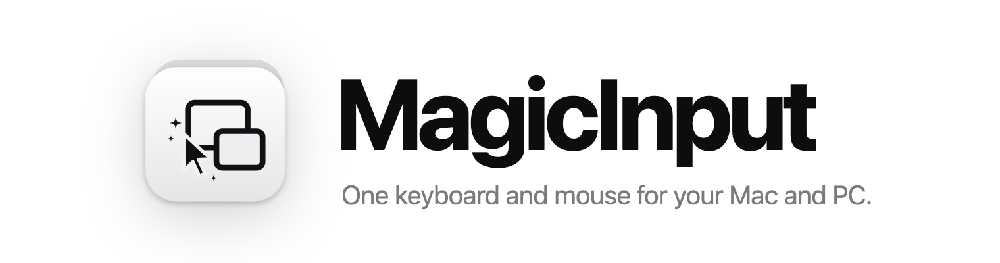
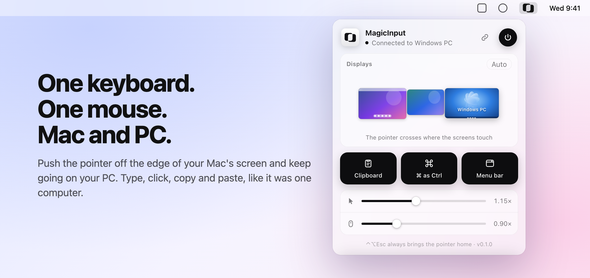
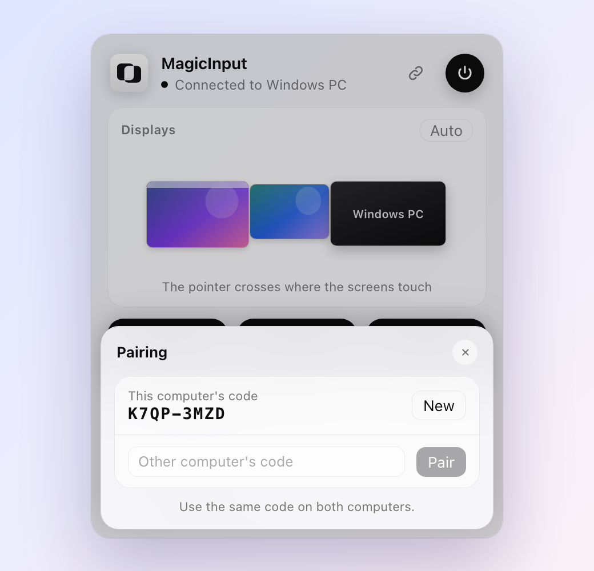
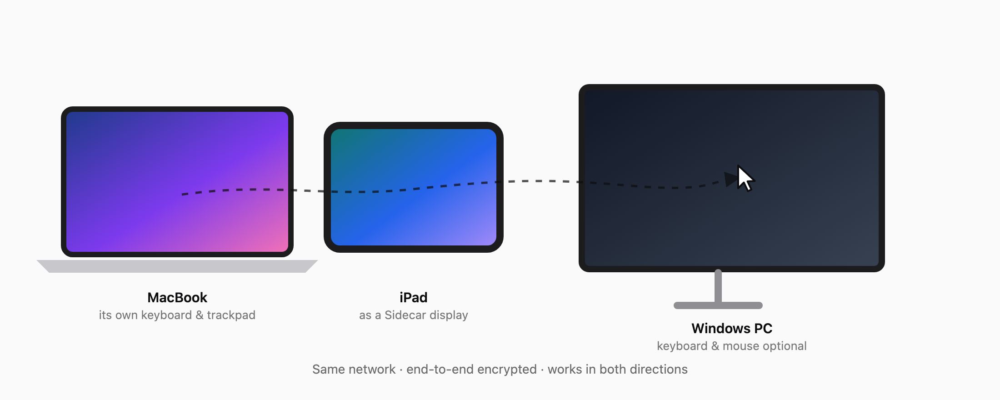

<div align="center">
  <picture>
    <source media="(prefers-color-scheme: dark)" srcset="assets/brand/magicinput-logo-dark.png">
    
  </picture>

  <p><strong>Use one keyboard and mouse across your Mac and your Windows PC.</strong></p>
  <p>Push the pointer off the edge of one screen and keep going on the other. Type, click, scroll, copy and paste, as if it were one computer. Like Universal Control, for PCs.</p>

  <p>
    <a href="https://github.com/betoxf/Magicinput/actions/workflows/ci.yml"></a>
    <a href="https://github.com/betoxf/Magicinput/releases/latest"></a>
    
    
    
    <a href="PRICING.md"></a>
  </p>

  <p>
    <a href="#installation">Install</a> ·
    <a href="#quick-start">Quick start</a> ·
    <a href="#set-it-up-with-an-ai-assistant">Set up with AI</a> ·
    <a href="#how-it-works">How it works</a> ·
    <a href="PRICING.md">Pricing</a> ·
    <a href="CHANGELOG.md">Changelog</a> ·
    <a href="docs/ARCHITECTURE.md">Architecture</a> ·
    <a href="CONTRIBUTING.md">Contributing</a> ·
    <a href="SECURITY.md">Security</a>
  </p>
</div>

<p align="center">
  <picture>
    <source media="(prefers-color-scheme: dark)" srcset="images/hero-dark.png">
    
  </picture>
</p>

## Why MagicInput

Your Mac's keyboard and trackpad are right there, and so is the PC's monitor. MagicInput lets one set of hands drive both, without a hardware switch or a cloud account.

| Capability | What it gives you |
| --- | --- |
| Works both ways | Drive the PC from the Mac, or the Mac from the PC's keyboard and mouse. Whichever you're touching is in charge. |
| Just push past the edge | **Auto** mode needs no setup: push firmly past the left or right edge. Or arrange the screens exactly. |
| Arrange like System Settings | Drag the PC next to your displays, iPad (Sidecar) included, and move the iPad itself. The pointer crosses only where the screens touch, at the matching height. |
| Keyboard follows the click | No keyboard on the PC? Click into a text field with its own mouse and keep typing on the Mac keyboard (and the other way round). |
| Copy and paste across | Copied text follows the pointer to the other computer. |
| Mac shortcuts on the PC | ⌘C copies on Windows (Ctrl and ⌘ swap automatically; can be turned off). |
| Private and local | Finds the other computer on your network by itself. Encrypted end to end, paired with a short code, refuses anything outside your local network. No account, no cloud, no telemetry. |
| Smooth on Wi-Fi | Late pointer updates are replayed as a quick glide instead of a jump. |
| Out of the way | Starts at login and runs at about 0.1% CPU. The settings panel only exists while it's open; the menu bar icon is optional. |
| Free, with every feature | Free for personal use. The source is public: read every line, have it audited, or build it yourself. |

## Installation

MagicInput is free for personal use, with every feature. Using it for a business needs a [business license](PRICING.md).

- **macOS:** download [`MagicInput.dmg`](https://github.com/betoxf/Magicinput/releases/latest/download/MagicInput.dmg), open it and drag **MagicInput** to Applications. It is signed and notarized by Apple and runs on Apple silicon and Intel. Or with Homebrew:

  ```bash
  brew install --cask betoxf/tap/magicinput
  ```

- **Windows:** download [`MagicInput-Setup.exe`](https://github.com/betoxf/Magicinput/releases/latest/download/MagicInput-Setup.exe), run it and click **Install**. It installs MagicInput for you, starts it at login, allows it through the firewall on private networks and adds it to the Start menu and to Settings → Apps. To update, run the new setup; your settings are kept.

> [!NOTE]
> The Windows setup isn't code-signed yet, so SmartScreen may say "Windows protected your PC" the first time. Click **More info → Run anyway**. You can check every download against `SHA256SUMS.txt` in the [release](https://github.com/betoxf/Magicinput/releases/latest).

### Requirements

- A Mac with macOS 13 Ventura or newer, and a PC with Windows 10 or 11 (64-bit)
- Both on the same local network (Wi-Fi or Ethernet)

## Quick start

1. **Install it on both computers** and open it once on each.
2. **On the Mac, allow access.** macOS asks for **Accessibility** and **Input Monitoring** for MagicInput (System Settings → Privacy & Security). It starts working as soon as both are on.
3. **Pair them.** In the panel, click the link icon to see this computer's code, and type it into **Other computer's code** on the other computer. They find each other automatically.
4. **Move across.** Push the pointer firmly past the left or right edge of your screen. To make it exact, drag the other computer to where it really sits in **Displays**.

**Switching to the other computer’s own mouse or keyboard?** A deliberate mouse movement, click, or key press reclaims control there. You can then cross its screen edge normally. Small mouse twitches are ignored.

**The keyboard follows your last click** when the clicked computer has no keyboard of its own. Click with the PC's own mouse (say, into a text field) and your Mac keyboard types there; click on the Mac again and it types on the Mac. It works the same the other way round. Moving a computer's own mouse deliberately also brings its keyboard back. Once a computer's own keyboard has been used, clicking it keeps each keyboard on its own computer: they only move together with the pointer when it crosses the edge. Turn it off entirely with `keyboard_follows_click = false` in the config file (`magicinput config` shows where it is).

An iPad participates as a display connected to your Mac through Sidecar; MagicInput does not require or provide a standalone iPad app.

**Control+Option+Esc** on the Mac (**Ctrl+Alt+Esc** on the PC) always brings the pointer home.

<p align="center">
  
</p>

## Set it up with an AI assistant

Using Claude, ChatGPT, Codex, Cursor or another assistant that can run commands? Paste this on each computer:

```text
Set up MagicInput on this computer by following
https://github.com/betoxf/Magicinput/blob/main/docs/AI_SETUP.md
Tell me when you need me to do something.
```

It installs MagicInput, works out whether this is the first or second computer, pairs them and checks the connection. You only click the permission switches on the Mac and the administrator prompt on Windows. Assistants can also run `magicinput status` at any time to see where things stand and what to do next.

## Using it

| Control | What it does |
| --- | --- |
| Menu bar / tray icon | Opens the panel (click away or press Esc to close). Hide it from its menu; opening MagicInput from Spotlight or the Start menu brings it back. |
| Displays | Your screens with their wallpapers, and the other computer. Drag the other computer along any edge; drag an iPad or external display to move it. **Auto** goes back to "push past the left or right edge". |
| Clipboard | Share copied text between the computers. |
| ⌘ as Ctrl | Swap Ctrl and ⌘ between Mac and Windows so shortcuts feel native. |
| Menu bar | Show or hide the icon. |
| Sliders | Pointer and scroll speed for input arriving from the other computer. |
| Power button | Start MagicInput at login (on) or stop it (off). |
| Link icon | Pairing: this computer's code, a new code, or the other computer's code. |

## How it works

<p align="center">
  <picture>
    <source media="(prefers-color-scheme: dark)" srcset="images/how-it-works-dark.png">
    
  </picture>
</p>

Each computer runs the same small background service. When the pointer reaches the edge that leads to the other computer, the service hides and freezes the local pointer and forwards your keyboard, mouse and scroll input over the network; the other computer replays it as if it came from its own devices. Crossing back hands control home again.

- **Discovery:** computers advertise themselves on the local network (Bonjour/mDNS) and only talk to ones using the same pairing code.
- **Encryption:** every connection uses the Noise protocol (X25519, ChaCha20-Poly1305) with a key derived from the pairing code. A wrong code can't connect, and the code itself is never sent.
- **Local only:** connections from outside your own subnet (internet, VPNs, Tailscale) are refused.
- **Keys:** keystrokes travel as layout-independent USB key codes, so each computer applies its own keyboard layout.
- **Smoothness:** each pointer update is timestamped; updates that Wi-Fi delivers late are replayed as a short glide.

See [Architecture](docs/ARCHITECTURE.md) for the details.

## Tips

- **Choppy pointer over Wi-Fi?** macOS uses a side channel (AWDL, for AirDrop, Sidecar and Universal Control) that pauses Wi-Fi for ~85 ms twice a second when your router is on a different 5 GHz channel. Setting the router's 5 GHz channel to **149** removes those pauses.
- **Can't click an admin window on the PC?** Windows blocks input into elevated apps unless the sender is elevated too; the installer's admin prompt takes care of this.
- **Discovery blocked on your network?** Point one computer at the other: `magicinput peer 192.168.1.20`.

## Privacy and security

- Input, clipboard text and settings travel only between your two computers, encrypted.
- MagicInput has no servers, no account and no telemetry. With a monthly or yearly license, it fetches a fresh key from bullfighterstudio.com about once a day; that's the only server it talks to.
- Nothing is accepted from outside your local network.
- The macOS permissions (Accessibility, Input Monitoring) are what any keyboard/mouse sharing tool needs to see and send input.
- The source code is public, so you or your security team can audit exactly what it does, and check the downloads against the published checksums ([how](PRICING.md#check-it-yourself)).

Report suspected vulnerabilities privately as described in the [security policy](SECURITY.md).

## Command line

The apps are all you need, but everything is scriptable. On a Mac the command is `/Applications/MagicInput.app/Contents/MacOS/magicinput`; on Windows, `magicinput.exe`.

| Command | What it does |
| --- | --- |
| `magicinput` | Open the settings panel |
| `magicinput pair [CODE]` | Make a new pairing code, or use the other computer's |
| `magicinput side auto\|left\|right\|top\|bottom` | Where the other computer is (auto by default) |
| `magicinput peer <address>` | Connect to a fixed address if discovery doesn't work (`auto` to undo) |
| `magicinput install` / `uninstall` | Start (or stop starting) at login |
| `magicinput status [--json]` | Installed? Running? Pairing code, connection, computers nearby, license, and the next step |
| `magicinput license [KEY]` | Show the license, or activate a business license key |
| `magicinput config` | Show settings and where they're stored |
| `magicinput run` | Run the background service in the foreground (for debugging) |

## Build from source

The same code as the downloads. You need [Rust](https://rustup.rs). For the Windows build from a Mac, also `brew install mingw-w64`.

```bash
git clone https://github.com/betoxf/Magicinput.git
cd magicinput
cargo test
./scripts/bundle-mac.sh          # dist/MagicInput.app (UNIVERSAL=1 for Intel + Apple silicon)
./scripts/package-windows.sh     # dist/windows/
```

## Repository map

```text
src/
  core.rs          switching state machine (edges, crossing, glide, layout sync)
  net.rs           encrypted connection, discovery, local-network check
  geom.rs          screen geometry and arrangement math
  keymap.rs        macOS / USB HID / Windows key translation
  platform/        input capture and injection (macOS event tap, Windows hooks)
  ui.rs, ui.html   settings panel and menu bar / tray icon
  service.rs       start at login (LaunchAgent / scheduled task)
assets/            icons and brand masters
images/            README images (sources in docs/media-src)
scripts/           bundle, package and release scripts
installer/         Mac disk image and Windows setup (NSIS) definitions
Casks/             Homebrew cask
docs/              architecture, releasing, release notes
```

## Project documentation

| Document | Purpose |
| --- | --- |
| [Architecture](docs/ARCHITECTURE.md) | Processes, protocol, security model and files. |
| [Contributing](CONTRIBUTING.md) | Local setup, change standards and validation. |
| [Releasing](docs/RELEASING.md) | Versioning, notarization and release checklist. |
| [Pricing](PRICING.md) | Free for personal use, business licenses, verifying downloads. |
| [Security](SECURITY.md) | Supported versions and private reporting. |
| [Code of Conduct](CODE_OF_CONDUCT.md) | Community expectations. |

## Contributing

Issues and focused pull requests are welcome. Start with [CONTRIBUTING.md](CONTRIBUTING.md) and use the issue forms.

## Acknowledgements

- [Synergy](https://symless.com/synergy), [Barrier](https://github.com/debauchee/barrier), [Input Leap](https://github.com/input-leap/input-leap) and [Deskflow](https://github.com/deskflow/deskflow), which proved software KVMs work
- Apple's Universal Control, for showing how effortless it should feel
- [snow](https://github.com/mcginty/snow), [tao and wry](https://github.com/tauri-apps), [mdns-sd](https://github.com/keepsimple1/mdns-sd) and the other crates this builds on

MagicInput is an independent project by bullfighterstudio and is not affiliated with, endorsed by, or sponsored by Apple or Microsoft.

## License

Copyright © 2026 bullfighterstudio. MagicInput is source-available under the [PolyForm Noncommercial License 1.0.0](LICENSE): free for personal and other noncommercial use; business use needs a [business license](PRICING.md) from [bullfighterstudio.com/magicinput](https://bullfighterstudio.com/magicinput#business). Versions 0.3.0 to 0.4.0 were released under the GPL-3.0 and versions up to 0.2.0 under the MIT License; they stay under those licenses.
